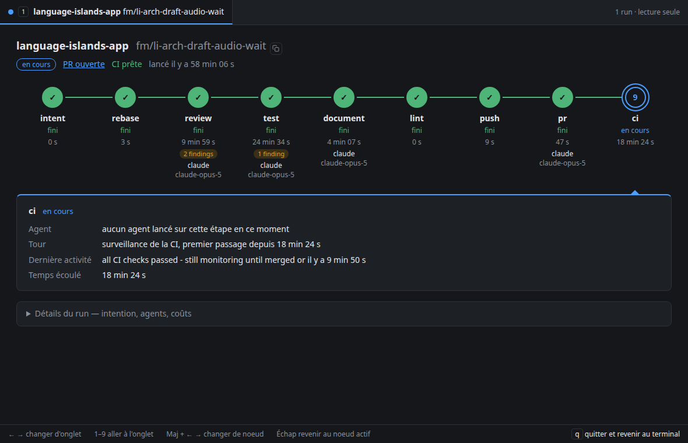

# no-mistakes-view

Une fenêtre qui montre, en direct, où en sont les runs no-mistakes de cette machine.

Un onglet par run en cours, titré projet et branche. Dans l'onglet, les neuf étapes (intent, rebase, review, test, document, lint, push, pr, ci) sont des noeuds reliés dans l'ordre, chacun avec son état, sa durée, son nombre de findings et les agents qu'il a utilisés. Sous le noeud actif : l'agent lancé (outil, modèle, effort), le tour en cours, la dernière activité et le temps écoulé.

no-mistakes peut renvoyer un run à une étape antérieure sans créer de nouveau run, par exemple quand une réparation de CI réécrit l'historique et qu'il refait les contrôles depuis la revue. La fenêtre compte alors les passages : l'onglet porte `↺2`, l'en-tête dit depuis quelle étape et à quelle heure le run est reparti, avec la raison lue dans le log, et les étapes déjà passées une fois sont marquées « à refaire ». Sous chaque noeud, seuls les agents du passage en cours apparaissent ; ceux des passages précédents restent dans le détail du noeud.

Le panneau du noeud liste aussi les findings eux-mêmes (id, sévérité, fichier) et le détail de chaque tour : durée, sélection (par qui, quels findings), résumé du correctif. Une étape sans signe de vie (aucune activité depuis 15 min, ou pid d'agent qui n'existe plus) porte un ⚠ sur le noeud, sur l'onglet et sur l'en-tête. Un run garé à un gate affiche depuis combien de temps il attend. L'en-tête du run montre le lien de la PR avec son état (ouverte, fusionnée) et la CI prête le cas échéant.

Un bloc dépliant, fermé par défaut, donne le reste par run : l'intention et sa source, les SHA de base et de tête, l'arbre de travail, la version de no-mistakes, la table de tous les appels d'agents finis, coupée par une ligne à chaque reprise et avec les passages précédents grisés (effort lu dans la config actuelle tant qu'elle donne encore le modèle de l'appel, durée, tokens d'entrée/sortie/cache/raisonnement, allers-retours, appels d'outils par type, statut de sortie, catégorie d'échec, fallback) avec les totaux du run, le temps d'attente face au temps actif, et les dernières lignes du log de l'étape en cours.

Un run fini garde son onglet 90 secondes avec son résultat, puis l'onglet se ferme. Sans run, l'écran le dit.



L'outil n'appelle aucun modèle et ne fait aucun appel réseau sortant. Il relit des fichiers locaux, rien d'autre : il ne coûte aucun token, ni aux agents ni au superviseur.

## Installation

Il faut Python 3 (bibliothèque standard seule, pas de dépendance) et, pour avoir une vraie fenêtre, un navigateur de la famille Chromium : Chrome, Chromium, Brave ou Edge. Sans lui, la vue s'ouvre dans un onglet du navigateur par défaut. L'outil lit le `~/.no-mistakes/` de la machine où il tourne : no-mistakes doit donc tourner sur la même machine.

### Linux

```sh
git clone https://github.com/NekodaMushi/no-mistakes-view.git
cd no-mistakes-view
./install.sh
```

Le script pose un lien `~/.local/bin/no-mistakes-view` vers `bin/no-mistakes-view`. Un autre dossier du PATH se passe en argument : `./install.sh ~/bin`. Le navigateur est cherché sur le PATH (`google-chrome`, `chromium`, `brave-browser`, `microsoft-edge`…).

### macOS

```sh
git clone https://github.com/NekodaMushi/no-mistakes-view.git
cd no-mistakes-view
./install.sh /opt/homebrew/bin   # ou /usr/local/bin sur un Mac Intel
```

`~/.local/bin` n'est pas dans le PATH d'un Mac par défaut, d'où le dossier passé en argument. Pour garder `~/.local/bin`, ajoutez `export PATH="$HOME/.local/bin:$PATH"` à `~/.zshrc`. Le Python 3 des outils de développement d'Apple (`xcode-select --install`) ou de Homebrew suffit. Le navigateur est cherché sur le PATH puis dans `/Applications` et `~/Applications` : Google Chrome, Chromium, Brave Browser, Microsoft Edge.

### Windows

Non pris en charge : la commande refuse de démarrer. Sous Windows, le test « ce pid existe-t-il encore ? » (`os.kill(pid, 0)`) termine le processus au lieu de le tester, et la vue tuerait les agents qu'elle surveille.

Linux est testé au quotidien. macOS est couvert par les tests unitaires (recherche du navigateur, dossier du profil) mais peu essayé en vrai : un retour en issue est bienvenu.

## Lancement

```sh
no-mistakes-view
```

La commande démarre un serveur lié à `127.0.0.1:47615` et ouvre une fenêtre du navigateur en mode application, avec un profil à part sous `~/.cache/no-mistakes-view/` (`~/Library/Caches/no-mistakes-view/` sur macOS). La touche `q` dans la fenêtre, ou Ctrl-C dans le terminal, ferme la fenêtre, arrête le serveur et rend la main au terminal ; fermer la fenêtre arrête aussi la commande. Un second lancement ouvre une fenêtre sur l'instance déjà en place et rend la main.

Options : `--port N`, `--linger SECONDES` (durée de vie de l'onglet d'un run fini), `--browser NOM`, `--no-window`.

Clavier : ← → changent d'onglet, 1 à 9 vont à un onglet, Maj + ← → changent de noeud, Échap revient au noeud actif, `q` quitte. La souris fait la même chose.

## D'où viennent les données

Tout vient de `~/.no-mistakes/`, en lecture seule :

- `state.sqlite`, ouvert avec `mode=ro` et `PRAGMA query_only` (`nmn/state.py`, `connect_readonly`) : tables `runs` (y compris intention, SHA, PR, `awaiting_agent_since`, `parked_ms`), `repos`, `step_results`, `step_rounds`, `agent_invocations`. Les colonnes absentes d'une base plus ancienne sont lues comme absentes, jamais une erreur.
- `config.yaml` : agent, modèle et effort configurés, y compris les rôles `reviewer` et `fixer` de la revue.
- `logs/<run>/<étape>.log` : la ligne `<outil> started pid=…` nomme l'agent réellement lancé, la dernière ligne sert d'activité, et les 30 dernières lignes alimentent le bloc de détails. Un pid relevé est testé localement (`os.kill(pid, 0)`) pour dire si l'agent existe encore.

La page redemande l'état toutes les 2 secondes. Le serveur ne relit la base que si ses fichiers ont bougé, et ne fait rien quand la fenêtre est cachée ou fermée. L'outil ne parle pas au démon, ne lance pas la commande `no-mistakes` et ne répond à aucun gate.

## Tests

```sh
python3 -m unittest discover -s tests
```

Les fixtures de `tests/fixtures/` sont copiées d'états réels par `tests/make_fixture.py`, qui retire le contenu des findings, les intentions, les chemins, toute URL hors boucle locale et toute colonne de fournisseur de modèle.

## Limites connues

- Runs de cette machine seulement. Pour suivre ceux d'une autre machine, un tunnel SSH suffit : `ssh -L 47615:127.0.0.1:47615 hôte`, puis `no-mistakes-view --no-window` sur l'hôte, et `http://localhost:47615` dans le navigateur local.
- no-mistakes n'enregistre un appel d'agent qu'une fois fini : la table des appels montre le passé de l'étape, pas l'agent en vol. Pour le noeud actif, l'outil vient du log de l'étape et le modèle de `config.yaml` ; un réglage d'agent propre à un dépôt (`.no-mistakes.yaml`) n'est pas lu.
- « Sans signe de vie » est un indice, pas une vérité : un agent qui réfléchit longtemps sans rien loger sera signalé à tort, et un pid réutilisé par un autre processus passera pour vivant.
- Si le démon meurt en laissant un run à l'état `running`, son onglet reste ouvert.
- Lire une base SQLite en mode WAL pose un verrou de lecture partagé très bref dans `state.sqlite-shm`, comme tout lecteur. Aucune donnée n'est écrite.
- Pas de pilotage, pas d'historique au-delà du temps d'affichage (linger), pas de notifications.
